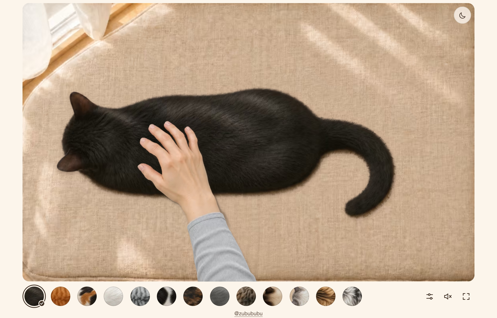

# 猫撫でシミュレーター（pet-the-cat 本地复刻）



原站：<https://pet-the-cat.pages.dev/>（作者 X：[@zubububu](https://x.com/zubububu)）

把原站那个「摸猫模拟器」完整解包成可读、可改、可离线运行的本地小游戏：
13 种毛色的猫趴在亚麻垫上，指针（或手指）在背上划过就会跟着抚动、毛发会被压出痕迹、
从尾根往外拉尾巴还能把尾巴拉长。支持深浅色主题、全屏、手机横屏、咕噜声音效。

## 运行

```bash
npm run pet          # = node scripts/serve-pet-cat.mjs，默认 http://localhost:8801/
```

或者任意静态服务器，例如 `python3 -m http.server 8801`（在 `pet-the-cat/` 目录里）。

> 不要用 `file://` 直接打开 `index.html`。游戏要把猫的贴图画进 canvas 再读像素来做毛发压痕和手指分割，
> `file://` 下图片属于不透明来源，`getImageData` 会抛 `SecurityError`；另外 `.avif` 也需要正确的
> `Content-Type: image/avif` 才会被解码。

## 目录

```
pet-the-cat/
├── index.html      骨架：原页面 body 结构（SVG 图标 + 面板 + 13 个毛色按钮）
├── style.css       原页面内联样式，原样导出
├── game.js         游戏逻辑（125KB，原样导出，仅改了资源读取那一处）
├── sprites.js      精灵清单：每个名字 → [offset, count, x, y, w, h, W, H]
├── assets/         27 张 AVIF：room 背景、13 只猫本体、13 条尾巴、hand-slim / grip-slim 两只手
└── source/         原站 574KB 打包页原件，留作还原时的输入与比对
```

## 原站是三层打包的，怎么还原的

1. 整个页面是 **UTF-16LE** 编码，`<body>` 里只有一个
   `<script type="application/octet-stream" id="pack">`，内容是"每字符 14 bit → 2 个 7 bit 字节"的准 base64。
2. 解出来是一段 3KB 的引导脚本，自带 **LZMA 解码器**（range coder，11 位概率）+ 字典解压器，
   把 564929 字节摊成 148225 字节，再解出 `{ CSS+HTML 串 / JS 串 / 资源目录 JSON / 资源二进制 }`。
3. 资源二进制里是 27 个 AVIF；每个精灵在 `directory` 里带 `x, y, w, h, W, H`：
   图是**裁剪过的**（只存了 `w×h` 区域，还有各自的缩放比），游戏把裁剪块贴回 `W×H` 的画布坐标上。

还原脚本把这三层全跑通了（Node 里用假 DOM 执行引导代码，直接捕获产物）：

```bash
npm run extract:pet    # = node scripts/extract-pet-cat.mjs
```

脚本会重新生成 `index.html` / `style.css` / `game.js` / `sprites.js` / `assets/*.avif`。
原站更新后，把新页面存成 `pet-the-cat/source/pet-the-cat.pages.dev.html` 再跑一次即可。

## 相对原站唯一的改动

`game.js` 里资源读取那一处：

```js
// 原版：从 document.currentScript.photos 里切 Blob
const [offset,count,x,y,w,h,W,H]=directory[name];
const url=URL.createObjectURL(new Blob([photos.subarray(offset,offset+count)],{type:'image/avif'}));

// 本地：直接指向解出来的文件
const [offset,count,x,y,w,h,W,H]=directory[name];
const url='assets/'+name+'.avif';
```

其余逻辑、样式、DOM、坐标、物理参数一行没动。`photos` 只在这一处被用到，所以换成文件路径等价。

## 改起来

- **换毛色贴图**：替换 `assets/<name>.avif`，同名即可；尺寸变了就同步改 `sprites.js` 里该条的
  `x, y, w, h, W, H`（`W, H` 是这套猫共用的整张画布坐标 `1517×935`，`x, y, w, h` 是猫在其中的包围盒）。
- **加一只猫**：加 `assets/xxx.avif` + `assets/xxx-tail.avif`，在 `sprites.js` 里加两条，
  再在 `index.html` 的毛色条里加一个 `<button data-cat="xxx" aria-label="日文名">`。
  名字表是 `game.js` 里从按钮的 `aria-label` 自动生成的（`Object.fromEntries(choices.map(...))`），不用改 JS。
- **调手感**：`game.js` 里的 `force` / `pressure` / `napFactor`（毛发法线）、`baseDigits` / `smallHand`
  （手指关节与分指多边形）、`heldPressure` 是主要旋钮。
- **`saba`（银渐层）是算出来的**，没有贴图：它用 `silverTabby()` 把 `mugi` 的贴图实时转成银灰虎斑，
  所以 `directory` 里没有 `saba`，`readPhoto` 里走了合成分支。

## 已验证

- 与原站同分辨率截图逐像素比对：差异像素 0.37%（其中明显差异 0.033%），基本可视为同一渲染。
- 13 种毛色逐个切换、背部抚摸、尾巴拉伸、键盘（空格 / T）、深浅主题、咕噜声开关、手机竖屏布局，
  控制台零报错、无 404。
